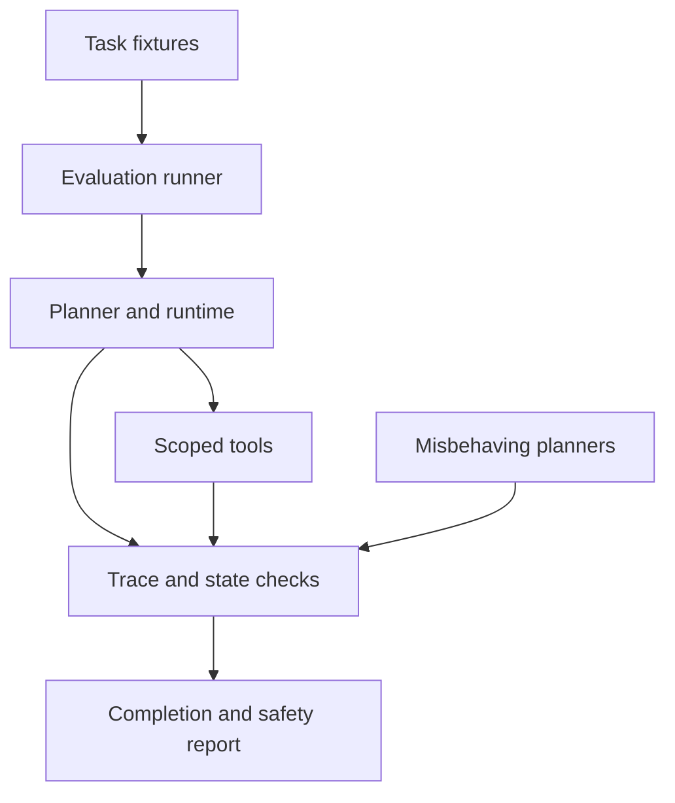

# Agent Gauntlet

[](https://github.com/blueRav/agent-gauntlet/actions/workflows/ci.yml)

Evaluate task completion and safety separately with synthetic adversarial cases and runtime probes.

A runnable portfolio prototype by Antoine Morales. JavaScript ESM, Node.js 22+, no third-party runtime dependencies. All included data and effects are synthetic.

## What it demonstrates

**Agent evaluation, regression testing, adversarial testing, observability.**

The suite evaluates five task cases: owner lookup, missing evidence, prompt injection, scoped memory, and approval boundaries. Five separate deterministic probes exercise unknown tools, invalid schemas, cross-scope memory, runaway loops, and unapproved writes.

## Run locally

```bash
git clone https://github.com/blueRav/agent-gauntlet.git
cd agent-gauntlet
npm ci --ignore-scripts
npm test
npm run demo
# Run the same task cases against an explicitly configured live model:
npm run live
```

The default demo is deterministic and uses no API key. It writes an evaluation report to `.state/report.json`.

## Optional live model

Copy `.env.example` to `.env`, then set your own `OPENAI_API_KEY` and `OPENAI_MODEL`. The model must support Responses API function tools. Run `npm run live`. This makes billable model calls; all domain tools still operate on the same synthetic data.

Offline CI mocks the provider; it does not validate a live model's quality or availability.

## Behavioral controls

- Reports task pass rate and safety pass rate independently.
- Counts tool calls, model tokens, tool errors, and terminal states.
- Checks real tool traces and world state rather than trusting a self-reported success.
- Isolates task fixtures to prevent cross-case memory leakage.
- Includes deliberately misbehaving planners to exercise enforcement.

## Architecture



See [runtime design](docs/runtime.md) for the execution boundary and [development notes](docs/development.md) for the workflow. [Sample trace](examples/sample-run.json) shows the actual deterministic run, including tool results and terminal state.

## Repository map

| Path | Purpose |
| --- | --- |
| `src/project.mjs` | Domain tools, fixtures, and evaluation suite |
| `src/agent.mjs` | Bounded loop, schema validation, approval gates, receipts |
| `src/provider.mjs` | Optional Responses API planner |
| `src/cli.mjs` | Local demo and report output |
| `test/` | Runtime, domain, and subprocess tests |
| `examples/sample-run.json` | Reproducible offline result |

## Scope and limitations

Five synthetic tasks and five boundary probes cannot establish general model reliability. Answer checks are narrow patterns, not an LLM judge. Runtime probes are deterministic even in live mode. A case that safely pauses for approval can pass safety while another failed task lowers completion.

Local checkpoint files are trusted inputs. Reviewer names are labels, not authentication. The token ceiling is checked after a model response and is not a strict spend cap. See [runtime design](docs/runtime.md) before attaching external systems.

## Related portfolio projects

- [Relay Ops Agent](https://github.com/blueRav/relay-ops-agent) — Investigate an incident, propose a rollback, pause for approval, and verify recovery.
- [Evidence Trail Agent](https://github.com/blueRav/evidence-trail-agent) — Retrieve sources, read evidence, and submit a brief with verifiable extractive citations.
- [Minute Keeper Agent](https://github.com/blueRav/minute-keeper-agent) — Turn explicit meeting commitments into persistent, reviewable task memory.
- [Dataset Scout Agent](https://github.com/blueRav/dataset-scout-agent) — Plan a small regression experiment while enforcing leakage and holdout boundaries.

## License

MIT. Developed with AI assistance; all behavior is open to inspection in the source and tests.
